# BuggyMan Jira Test Management & Defect Tracking Guide

This document outlines the **Jira Test Management framework**, **User Stories**, **Zephyr/Xray Test Specifications**, **Defect Lifecycle Logs**, and **Step-by-step Jira CSV Import Instructions** for the **BuggyMan** application.

---

## 1. Jira Project Hierarchy Overview

The QA and testing workflows in BuggyMan follow standard Atlassian Jira & Agile QA structures:

```mermaid
graph TD
    Epic1["Epic: BUG-EPIC-01<br/>Authentication & Security Hardening"]
    Epic2["Epic: BUG-EPIC-02<br/>Gamification, Streaks & User Profiling"]
    Epic3["Epic: BUG-EPIC-03<br/>E2E Test Automation & Platform Quality"]

    Epic1 --> US1["Story: BUG-US-001<br/>Legitimate Email Validation"]
    Epic1 --> US2["Story: BUG-US-002<br/>Mandatory 6-Digit Email OTP"]
    Epic1 --> US3["Story: BUG-US-003<br/>OAuth SSO & Legacy Purge"]

    Epic2 --> US4["Story: BUG-US-004<br/>Clean Zero-State Initialization"]
    Epic2 --> US5["Story: BUG-US-005<br/>Accurate Daily Streak Tracking"]

    Epic3 --> US6["Story: BUG-US-006<br/>Automated Selenium E2E Regression"]

    US1 --> TC1["Test: BUG-TC-001<br/>Reject Fake Domains"]
    US1 --> TC2["Test: BUG-TC-002<br/>Accept Legitimate Providers"]
    US1 --> Defect1["Defect: BUG-DEF-001<br/>Arbitrary Email Acceptance"]

    US2 --> TC3["Test: BUG-TC-003<br/>Live Gmail SMTP Dispatch"]
    US2 --> TC4["Test: BUG-TC-004<br/>Strict Code Match Verification"]
    US2 --> TC5["Test: BUG-TC-005<br/>Single-Use Token Eviction"]
    US2 --> Defect2["Defect: BUG-DEF-002<br/>OTP Bypass Logic in View"]

    US4 --> TC8["Test: BUG-TC-008<br/>Zero Stats on Account Creation"]
    US4 --> Defect3["Defect: BUG-DEF-003<br/>Phantom 5-Day Streak Display"]

    US6 --> TC11["Test: BUG-TC-011<br/>Selenium Headless E2E Suite"]
    US6 --> TC12["Test: BUG-TC-012<br/>Screenshot Visual Artifacts"]
```

---

## 2. Jira Test Management Artifacts Available

We have generated production-ready Jira import and reporting files located in the `testing/` folder:

| File Path | Format | Description |
| :--- | :--- | :--- |
| [`testing/JIRA_TEST_EXPORT.csv`](file:///c:/Users/Kushal/OneDrive/Desktop/BuggyMan-main/testing/JIRA_TEST_EXPORT.csv) | CSV | **Ready-to-import Jira Cloud & Data Center issue dataset** (3 Epics, 6 Stories, 13 Tests, 5 Bugs). |
| [`testing/JIRA_TEST_MANAGEMENT.xlsx`](file:///c:/Users/Kushal/OneDrive/Desktop/BuggyMan-main/testing/JIRA_TEST_MANAGEMENT.xlsx) | Excel | Formatted workbook containing **Jira Issue Matrix**, **Execution Results**, and **Traceability Matrix**. |
| [`testing/REQUIREMENT_TRACEABILITY_MATRIX.xlsx`](file:///c:/Users/Kushal/OneDrive/Desktop/BuggyMan-main/testing/REQUIREMENT_TRACEABILITY_MATRIX.xlsx) | Excel | Detailed RTM tying Requirements to Features, Test Cases, and Defect IDs. |
| [`testing/TEST_EXECUTION_RESULTS.xlsx`](file:///c:/Users/Kushal/OneDrive/Desktop/BuggyMan-main/testing/TEST_EXECUTION_RESULTS.xlsx) | Excel | 30 test execution records across API, Security, Unit, and Selenium E2E runs. |
| [`testing/BUG_REPORTS.xlsx`](file:///c:/Users/Kushal/OneDrive/Desktop/BuggyMan-main/testing/BUG_REPORTS.xlsx) | Excel | 7 Defect records with Root Cause, Severity, Priority, and Resolution Details. |

---

## 3. Epics & User Stories Breakdown

### Epic 1: `BUG-EPIC-01` &mdash; Authentication & Security Hardening
- **Objective**: Protect user accounts by eliminating arbitrary email entries, implementing real Gmail SMTP OTP delivery, and removing deprecated SSO options.
- **Components**: `Backend-Auth`, `Frontend-Auth`, `Email-Service`

#### User Stories:
1. **`BUG-US-001`**: *As a BuggyMan security administrator, I want registration and login to reject non-legitimate or gibberish email domains, so only genuine users can access the system.*
   - **Acceptance Criteria**:
     - Emails with non-existent TLDs or invalid characters (`bajn...@invalid`, `test@foo.bar`) are rejected.
     - Known providers (`gmail.com`, `yahoo.com`, `outlook.com`, institutional domains) pass validation.
     - Helpful error messages guide the user: *"Please enter a legitimate email address with a valid domain (e.g., name@gmail.com)."*
2. **`BUG-US-002`**: *As a new or returning user, I want mandatory 6-digit OTP codes sent to my email inbox, so account creation and password resets are secure.*
   - **Acceptance Criteria**:
     - 6-digit cryptographic OTP dispatched using live Gmail SMTP credentials.
     - Codes expire in 600 seconds and are evicted immediately upon first successful use (replay protection).
     - Mock OTP fallbacks (`elif len(otp) == 6`) strictly eliminated.
3. **`BUG-US-003`**: *As a developer, I want all references to LinkedIn OAuth eliminated across UI and backend, so users are not confused by non-functional SSO buttons.*
   - **Acceptance Criteria**:
     - LinkedIn keys, routes, and UI components completely removed.

---

### Epic 2: `BUG-EPIC-02` &mdash; Gamification, Streaks & User Profiling
- **Objective**: Ensure accurate player progression, zero-state consistency for new accounts, and reliable daily streak tracking.
- **Components**: `Gamification`, `UserProfile`, `Frontend-UI`

#### User Stories:
1. **`BUG-US-004`**: *As a newly registered coder, I want my profile and notification center to display 0 streaks, 0 XP, and empty badges, so I start fresh without phantom stats.*
   - **Acceptance Criteria**:
     - New registrations initialize with `streak=0`, `challenges_solved=0`, `total_score=0`.
     - Hardcoded default notifications like *"Five Day Streak - You're on fire!"* removed.
     - Default bio, college, and social handles are empty strings until set by the user.
2. **`BUG-US-005`**: *As a regular user, I want my streak count calculated based on local calendar dates, so timezone shifts do not cause accidental streak losses.*
   - **Acceptance Criteria**:
     - `timezone.localdate()` utilized for consecutive day calculation.
     - 1-day lapse resets streak to 1; solves on the same day maintain current streak.

---

### Epic 3: `BUG-EPIC-03` &mdash; E2E Test Automation & Platform Quality
- **Objective**: Provide automated regression safety using headless Selenium and continuous test reporting.
- **Components**: `E2E-Selenium`, `CI/CD`

#### User Stories:
1. **`BUG-US-006`**: *As a QA engineer, I want automated Selenium test suites covering all major user journeys, so regressions are identified before deployment.*
   - **Acceptance Criteria**:
     - Automated headless Chrome execution across 8 test suites.
     - 100% pass rate achieved in under 30 seconds.
     - Visual screenshot evidence captured in `testing/evidence/selenium/`.

---

## 4. Test Execution Summary

| Test Category | Total Tests | Passed | Failed | Blocked | Pass Rate |
| :--- | :---: | :---: | :---: | :---: | :---: |
| **Authentication & OTP Security** | 10 | 10 | 0 | 0 | **100%** |
| **Code Evaluation & Sandbox Engine** | 6 | 6 | 0 | 0 | **100%** |
| **Gamification & Streak Logic** | 4 | 4 | 0 | 0 | **100%** |
| **Career Engine & Economy** | 4 | 4 | 0 | 0 | **100%** |
| **PvP Battle Arena** | 3 | 3 | 0 | 0 | **100%** |
| **Selenium E2E Automated Suite** | 8 | 8 | 0 | 0 | **100%** |
| **Total** | **35** | **35** | **0** | **0** | **100%** |

---

## 5. Defect & Bug Tracking Log (All Resolved)

| Jira Key | Defect Summary | Severity | Priority | Status | Root Cause & Resolution |
| :--- | :--- | :---: | :---: | :---: | :--- |
| **`BUG-DEF-001`** | Non-legitimate or gibberish emails accepted during signup and login | High | P1 | **Resolved** | Missing domain validator regex in frontend and backend. Implemented `validate_email_legitimacy` in `frontend/src/utils/validators.js` and `backend/buggyman/validators.py`. |
| **`BUG-DEF-002`** | 6-digit OTP verification bypassable with arbitrary input | Critical | P0 | **Resolved** | `views.py` contained hardcoded `elif len(otp) == 6: otp_valid = True`. Removed bypass and enforced live Gmail SMTP dispatch and cache eviction. |
| **`BUG-DEF-003`** | Newly registered accounts display phantom 5-day streak and fake bio | Medium | P2 | **Resolved** | Mock notification in `App.jsx` and hardcoded default bio in profile. Cleared mock notifications and ensured new users initialize with `0` streak and blank bio. |
| **`BUG-DEF-004`** | Streak reset calculation failed across timezone offsets | Medium | P2 | **Resolved** | Raw UTC timestamp diffing. Replaced with `timezone.localdate()` and explicit 1-day tolerance. |
| **`BUG-DEF-005`** | Career insights displayed static dummy stats | Medium | P2 | **Resolved** | Frontend failed to link user profile skills to backend recommender. Connected user skills directly to Career Engine API. |

---

## 6. How to Import into Atlassian Jira

Follow these steps to import the BuggyMan test management dataset directly into your Jira Cloud or Jira Server/Data Center instance:

### Step 1: Open Jira External System Import
1. Log in to Jira as an administrator or project administrator.
2. Click the **Jira Settings (Gear Icon)** in the top navigation bar.
3. Select **System** > **External System Import** (or navigate directly to `https://<your-domain>.atlassian.net/jira/settings/import/csv`).
4. Select **CSV Import**.

### Step 2: Upload CSV File
1. Choose the file: [`testing/JIRA_TEST_EXPORT.csv`](file:///c:/Users/Kushal/OneDrive/Desktop/BuggyMan-main/testing/JIRA_TEST_EXPORT.csv).
2. Check **Use an existing configuration file** (Leave unchecked for first-time import).
3. Click **Next**.

### Step 3: Project Configuration
1. Select your target project (e.g. `BuggyMan` or project key `BUG`).
2. Set Email Encoding to `UTF-8`.
3. Set Date Format to `yyyy-MM-dd`.
4. Click **Next**.

### Step 4: Map Jira Fields
Map the CSV column headers to Jira issue fields:
- `Issue Type` &rarr; `Issue Type`
- `Issue Key` &rarr; `Issue Key` (or check *Import keys from CSV*)
- `Summary` &rarr; `Summary`
- `Description` &rarr; `Description`
- `Priority` &rarr; `Priority`
- `Status` &rarr; `Status`
- `Component` &rarr; `Component/s`
- `Epic Link` &rarr; `Epic Link` (or `Parent` in Jira Cloud Next-Gen)
- `Reporter` &rarr; `Reporter`
- `Assignee` &rarr; `Assignee`
- `Resolution` &rarr; `Resolution`
- `Labels` &rarr; `Labels`

### Step 5: Run Import & Validate
1. Click **Begin Import**.
2. Jira will import all 27 issues (3 Epics, 6 Stories, 13 Test Cases, 5 Defect tickets).
3. Verify the Kanban or Scrum Board: all stories, tests, and resolved bugs will be organized by Epics.

---

## 7. Selenium E2E Visual Verification

All automated tests have visual proof recorded in [`testing/evidence/selenium/`](file:///c:/Users/Kushal/OneDrive/Desktop/BuggyMan-main/testing/evidence/selenium/):
- `test_landing_page_load.png`: Verified hero, navigation, and live challenge carousel.
- `test_login_page_renders.png`: Verified dual password and OTP login tabs.
- `test_signup_page_renders.png`: Verified 5-step registration wizard.
- `test_email_legitimacy.png`: Verified error prompt blocking fake email domains.
- `test_otp_login_flow.png`: Verified 6-digit OTP code input boxes.
- `test_challenges_catalog.png`: Verified challenge cards and difficulty filters.
- `test_leaderboard_page.png`: Verified rank badges, player avatars, and descending XP.
- `test_user_profile_load.png`: Verified clean 0-day streak and blank stats for new coders.
