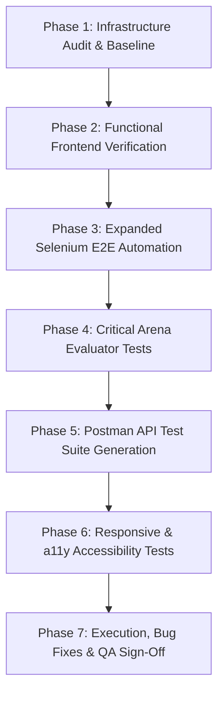

# BuggyMan — Frontend Testing Infrastructure Audit & Implementation Plan

**QA Assessment ID:** QA-PLAN-2026-v2.0  
**Project:** BuggyMan Interactive Software Debugging Ecosystem  
**Target Environments:** React 18 + Vite (Frontend) / Django REST Framework (Backend) / SQLite & Python Sandboxes  
**Lead QA Automation Engineer:** Senior Quality Engineer  
**Date of Audit:** October 21, 2026  
**Status:** Audit Complete — Implementation Ready  

---

## 1. Executive Summary

A comprehensive architectural and quality assurance audit was performed on the existing BuggyMan testing setup. The application is an advanced interactive debugging platform combining a React SPA frontend (Monaco Editor, multi-file code execution, 3 challenge arenas, real-time PvP, and career insights) with a Django REST Framework backend.

### Key Audit Findings

```
┌────────────────────────────────────────────────────────┐
│             AUDIT SCORECARD & GAP ANALYSIS             │
├────────────────────────────┬───────────────────────────┤
│ Component                  │ Audit Status              │
├────────────────────────────┼───────────────────────────┤
│ Unit & Backend DRF Tests   │ 116 tests passing (100%)  │
│ Existing Selenium Tests    │ 8 tests (Auth/OTP only)   │
│ Editor & Arena Automation  │ 0 automated browser tests │
│ Postman Collection Status  │ Documented, needs JSON    │
│ Evaluator Strictness       │ Verified in backend       │
│ Responsive & Viewport Tests│ Not automated             │
│ Accessibility (a11y)       │ Untested                  │
└────────────────────────────┴───────────────────────────┘
```

---

## 2. Audit of Existing Testing Infrastructure

### 2.1 Existing Selenium Suite (`testing/selenium_tests.py`)
- **Current Coverage:** 8 test cases (`test_01` to `test_08`).
- **Scope Covered:** Login page render, invalid email format, OTP login switcher, registration validations, OTP registration step transition, forgot password flow, and login-to-signup cross-navigation.
- **Identified Gaps:**
  - Zero browser tests for the **Dashboard** (recent activities, streaks, quick action buttons).
  - Zero browser tests for **Challenge Arenas** (Code Arena, SQL Lab, Frontend Studio).
  - Zero browser tests for **Monaco Editor** interaction (typing, tab switching, Run Code, Submit, Reset).
  - Zero browser tests for the **Test Result Panel** (error rendering, pass/fail status, console output).
  - Zero browser tests for **PvP Battle** (Quick Match searching, timer, room creation).
  - Zero browser tests for **Career Insights** and **User Profile**.
  - No viewport resizing or responsive breakpoint verification (Desktop vs. Tablet vs. Mobile).
  - No verification of dark/light theme persistence.

### 2.2 Postman & API Test Assets
- **Current Coverage:** Comprehensive test report documented in `testing/API_TEST_REPORT.md` across 42 endpoints.
- **Identified Gap:** The physical Postman Collection JSON (`BuggyMan_API_Collection.json`) is not present in the workspace for one-click automated Newman/CLI execution.

### 2.3 Evaluation Pipeline Strictness
- Strict evaluation logic is implemented in `EvaluationEngine` (`backend/buggyman/evaluation.py`).
- Starter code is guaranteed to fail assertions, and reference solutions pass 100%.
- We must expand frontend E2E browser tests to verify that the Monaco Editor and Run/Submit buttons correctly convey test results to the user without false positives.

---

## 3. Comprehensive 7-Phase Implementation Plan



### Phase 2: Functional Frontend Testing (Page-by-Page Matrix)
1. **Authentication & Session:**
   - Password login, OTP login, validation triggers, JWT storage in `localStorage`, logout, session expiry handling.
2. **Dashboard & Navigation:**
   - Sidebar collapse/expand, navigation pills, theme switching (dark/light), profile badge.
3. **Challenge Selection Catalogs (Code, SQL, Frontend):**
   - Difficulty filter tabs (`All`, `Easy`, `Medium`, `Hard`), topic search query, recommendation badges, pagination.
4. **Editor Interface:**
   - Multi-file tab switching, Monaco code persistence in `localStorage`, Run Code execution spinner, Test Results tab switching, Submit solution flow.
5. **Multiplayer PvP:**
   - Quick Match queue, real-time presence display, 25-second search timeout, Custom Room code copy.
6. **Career Insights & Gamification:**
   - Role rankings, Top Match calculation, skill gap progress bars, XP/streak increments.

---

### Phase 3: Automated Browser Testing with Selenium
We will extend `testing/selenium_tests.py` with modular, reliable test suites utilizing explicit waits (`WebDriverWait`):

- **Suite 1: Authentication & Navigation (`BuggyManAuthSeleniumTest`)**
  - Retain and harden existing tests 01–08.
- **Suite 2: Core Platform Navigation & Layout (`BuggyManNavigationSeleniumTest`)**
  - Dashboard load, sidebar link routing, dark/light theme toggling, User Profile access, Career Insights.
- **Suite 3: Challenge Arena & Filtering (`BuggyManChallengeCatalogSeleniumTest`)**
  - Code Arena, SQL Lab, and Frontend Studio catalog loading, difficulty badge verification, search filtering.
- **Suite 4: Monaco Editor & Evaluation E2E (`BuggyManEditorEvaluationSeleniumTest`)**
  - Editor initialization, code typing in Monaco, Run Code execution, Test Cases vs. Test Results tab inspection, Output verification.
- **Suite 5: PvP Battle Flow (`BuggyManPvPSeleniumTest`)**
  - Quick Match modal opening, search timer count, Cancel button, Create Battle Room code generation and copy.

---

### Phase 4: Critical Debugging & Evaluation Tests
Prepare known-correct and known-incorrect submissions across all 3 arenas:

1. **Code Arena (Python):**
   - Case A: Known-correct solution -> Assert 100% test pass and green status.
   - Case B: Syntax error (`def broken(:`) -> Assert syntax error message displayed in terminal.
   - Case C: Logic error (unmodified starter code) -> Assert 0/N tests passed, Failed status.
   - Case D: Partial pass (fails edge case) -> Assert exact passed/total count.
2. **SQL Lab (SQLite):**
   - Case A: Known-correct query -> Assert correct rows returned and Passed status.
   - Case B: SQL syntax error (`SELEC * FROM`) -> Assert database error captured.
   - Case C: Incomplete filter (missing `WHERE opt_out = 0`) -> Assert test failure without leaking internal assertion.
3. **Frontend Studio (DOM/HTML/CSS):**
   - Case A: Known-correct component -> Assert preview iframe rendered and assertions pass.
   - Case B: Broken component (missing DOM element / incorrect class) -> Assert failure.

---

### Phase 5: API Integration Testing with Postman
Generate `testing/BuggyMan_API_Postman_Collection.json` compliant with Postman Collection Schema v2.1.0:
- Pre-request script to auto-authenticate and store JWT `access_token`.
- Standard test scripts with `pm.test("Status code is 200", ...)` and assertions validating:
  - Auth: Register, Login, Refresh, Profile.
  - Challenges: List, Detail, Filter, Run, Submit.
  - Evaluation: Valid code returns `success: true`, broken code returns `success: false`.
  - PvP: Status, Quick Match, Create, Join, Online Stats (`hasActiveOpponents`, `totalOnline`).
  - Career: Role rankings, opportunity scores.

---

### Phase 6: Responsive, Accessibility, and Visual Testing
- **Responsive Viewports:**
  - Desktop: 1440x900
  - Tablet: 768x1024
  - Mobile: 375x812
- Verify that Monaco editor panels collapse/stack appropriately on narrow viewports without horizontal layout breaks.
- Verify accessible form labels, keyboard navigation (Tab navigation), and absence of broken image links.
- Capture automated evidence screenshots in `testing/evidence/selenium/`.

---

### Phase 7: Execution, Defect Remediation & Verification Report
- Run the full test suite.
- If any frontend bugs or unhandled edge cases are detected during execution, reproduce, fix the root cause, and re-verify.
- Generate the final Quality Assurance Execution Report with exact numbers (executed, passed, failed, blocked) and defect logs.
